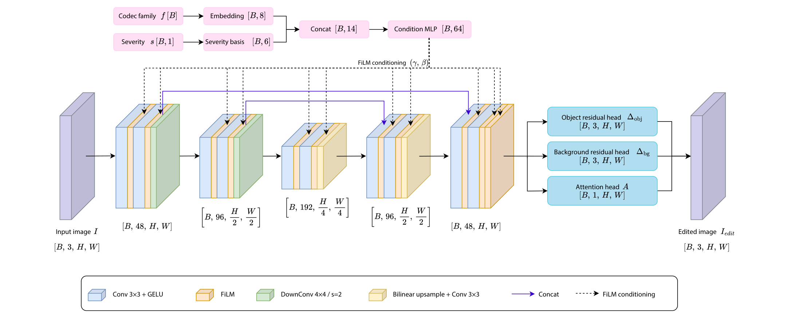
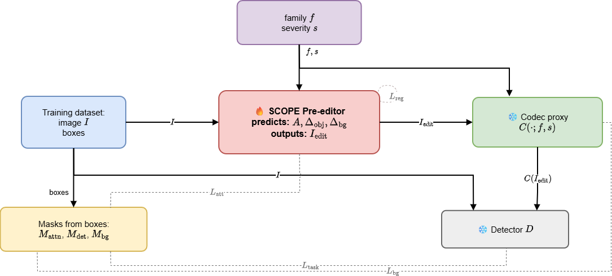

# SCOPE: Semantic COdec Pre-Editing for Object-Preserving Compression

Official implementation of:

**SCOPE: Semantic COdec Pre-Editing for Object-Preserving Compression**  
Silvia Dani, Leonardo Galteri, Marco Bertini

**SCOPE** is a conditional image pre-editor that improves the **bitrate–object-detection accuracy trade-off** by adapting images *before* compression. A single network uses **codec-family** and **compression-severity** conditioning to operate across multiple compression settings, without modifying the codec or downstream detector.

The pre-editor learns to **protect object-relevant information** while simplifying less important background content, making images easier to compress without sacrificing the visual cues needed for detection.

> 📄 **Paper:** Proceedings link will be added once available.  
> 🧠 **Pretrained weights (full model + ablations):** [Google Drive](https://drive.google.com/drive/folders/1YbB1M0Bdp1QZl-aoGNWCCsJRMgzROGES?usp=sharing)  
> 💻 **Code:** [SilviaDani/SCOPE](https://github.com/SilviaDani/SCOPE)

## ✨ Highlights

- 🎛️ **Family + severity conditioning:** One pre-editor adapts to different codecs and compression strengths.
- 🎯 **Object-preserving pre-editing:** Attention-guided object residuals and background simplification.
- 🧪 **Task-aware learning:** Differentiable codec proxies and feature supervision from a frozen detector.
- 🔌 **Standard compatibility:** The compressed output remains a conventional image; codecs and detectors are unchanged.
- 🌍 **Zero-shot transfer:** Evaluation on unseen **Cheng** and **JPEG2000** codecs.
- 📉 **Rate savings:** **−15.98% mean BDBR** across nine codec–detector pairs in the paper.

## 🧠 Architecture



*Figure 1. SCOPE's codec-family and severity conditions modulate a U-Net-style image branch through FiLM layers. The model predicts an attention map and object/background residuals to construct the edited image.*

The conditioning branch embeds the codec family and maps normalized severity to a nonlinear basis. The image branch predicts **attention** `A`, an **object residual** and a **background residual**. Their combination yields an edited image for a standard encoder.

## 🔥 Training pipeline



*Figure 2. Only the SCOPE pre-editor is optimized. Ground-truth boxes construct training masks; differentiable codec proxies and a frozen detector supply training supervision.*

During training, SCOPE samples from three differentiable codec families—**Diff-JPEG**, **BMSHJ**, and **BPG-like**—over different severity levels. At inference, **no boxes, masks, or detector forward pass are needed to produce the edited image**: only the image and the desired codec condition are provided to SCOPE.

## 📊 Results

We evaluate on **COCO 2017 validation** using Faster R-CNN (ResNeXt-101-FPN), RT-DETR-l, and YOLO26x. **Negative BDBR** indicates a lower bitrate at equivalent detection AP.

### 🎛️ Conditioning ablation

| Model | Mean BDBR vs. direct compression (%) |
|:--|--:|
| **SCOPE · family + severity** | **−15.98** |
| Family only | −15.42 |
| Severity only | −13.28 |

*Average over the nine JPEG/BPG/BMSHJ × detector comparisons. Full codec-specific and per-detector results, including specialist models, are provided in Table 3 of the paper.*

### 🌍 Generalization to unseen codecs

| Unseen codec | Evaluation setting | Result |
|:--|:--|--:|
| Cheng | SCOPE, Faster R-CNN | **−20.66% BDBR** |
| JPEG2000 | Diff-JPEG family condition, mean across detectors | −1.35% BDBR |
| JPEG2000 | BMSHJ family condition, mean across detectors | −9.97% BDBR |
| JPEG2000 | BPG-like family condition, mean across detectors | **−11.92% BDBR** |

**JPEG2000 uses a seen-family condition**, not a separately learned wavelet embedding: the codec is unseen, while the pre-editor conditions on `diff_jpeg`, `bmshj`, or `bpg_like`.

## 📁 Repository layout

```text
SCOPE/
├── README.md
├── training/                         # Training commands
│   ├── train_scope.py                # Direct Python entry point
│   └── train_scope.sh                # Full training configuration
├── evaluation/                       # Detection, timing, and visualization commands
│   ├── evaluate_yolo26x_codecs.py    # Codec encode/decode + YOLO26x
│   ├── evaluate_rtdetr_l_saved.py     # RT-DETR-l on saved reconstructions
│   ├── evaluate_fasterrcnn_x101_fpn_saved.py  # Detectron2 Faster R-CNN
│   ├── benchmark_scope.py            # Pre-editing latency
│   ├── evaluate_categories.py        # Per-category COCO metrics
│   └── visualize_results.py          # Qualitative visualizations
├── analysis/
│   └── compute_bdbr.py              # BDBR, equal-rate comparisons, LaTeX tables
├── scope/                            # Reusable model and pipeline implementation
│   ├── model.py                      # FiLM-conditioned SCOPE network
│   ├── conditioning.py               # Codec/severity representation
│   ├── inference.py                  # Checkpoint loading and pre-editing
│   ├── data.py                       # COCO crops and masks
│   ├── codecs.py                     # Differentiable training proxies
│   ├── losses.py                     # Training objectives
│   ├── teachers.py                   # Frozen detector supervision
│   ├── training.py                   # Training/validation/checkpoint logic
│   ├── train_scope.py                # Internal training CLI implementation
│   └── evaluation/                  # Codec, detector, metric, BDBR internals
├── configs/
│   ├── eval.yaml                     # Main seen/unseen codec comparisons
│   ├── ablation.yaml                 # JPEG2000 seen-family conditioning
│   └── timing.yaml                   # Timing experiments
├── tests/                            # Synthetic regression/integration tests
├── tools/                            # Optional quality and environment checks
│   ├── run_full_tests.py
│   ├── validate_environment.py
│   ├── check_runtime.py
│   └── audit_code.py
├── docs/
│   ├── PIPELINE.md
│   ├── TESTING.md
│   └── images/
│       ├── scope_architecture.png
│       └── scope_training_pipeline.png
└── requirements.txt
```

The top-level `training/`, `evaluation/`, and `analysis/` files provide **direct commands**; the reusable implementations remain in the `scope/` Python package. The separate `tests/` and `tools/` folders are optional checks, not required for inference. See the [📖 pipeline reference](docs/PIPELINE.md) for the complete file-by-file breakdown.

## ⚙️ Installation

**Python 3.10** and a Linux system with an NVIDIA GPU are recommended for reproducing the paper. Install all regular Python dependencies from **`requirements.txt`**; no Conda environment YAML is needed. The requirements pin PyTorch 2.4.1 and TorchVision 0.19.1 and include the CUDA 12.1 wheel index used by the original environment. Confirm that your NVIDIA driver supports this CUDA runtime.

```bash
git clone https://github.com/SilviaDani/SCOPE.git
cd SCOPE

# Create an isolated Python environment
python3.10 -m venv .venv
source .venv/bin/activate
pip install --upgrade pip setuptools wheel

# All standard Python dependencies, including PyTorch and Diff-JPEG
pip install -r requirements.txt

# Detectron2: install after PyTorch because it builds native extensions
pip install --no-build-isolation 'git+https://github.com/facebookresearch/detectron2.git'
```

If you prefer Conda, use `conda create -n d2_scope python=3.10 -y` followed by `conda activate d2_scope`, then run the **same pip commands**; no Conda YAML file is required. Detectron2 is installed separately because its build must use the installed PyTorch and CUDA toolkit. This may also require a system C++ compiler and a matching CUDA toolkit (`nvcc`), which pip does not install. See [Detectron2's installation guide](https://github.com/facebookresearch/detectron2/blob/main/INSTALL.md). Change the PyTorch CUDA wheel index if your platform requires another CUDA variant.

Verify the Python environment before downloading models:

```bash
python -c "import torch, yaml, ultralytics, compressai, pycocotools; print('torch:', torch.__version__, '| CUDA:', torch.cuda.is_available())"
python -c "import detectron2; print('Detectron2 import: OK')"
python tools/validate_environment.py --mode static
```

For **real BPG** compression, install the external [`bpgenc` and `bpgdec` tools](https://www.bellard.org/bpg/). For **JPEG2000 transfer experiments only**, install [OpenJPEG](https://github.com/uclouvain/openjpeg) (`opj_compress` and `opj_decompress`). These programs are *not* installed by either Python dependency file. Check them with `command -v bpgenc`, `command -v bpgdec`, and (when needed) `command -v opj_compress` / `command -v opj_decompress`.

### 📦 What to download before training or evaluation

| Asset | Training from scratch | Main YOLO26x evaluation | RT-DETR-l / Faster R-CNN evaluation |
|:--|:--:|:--:|:--:|
| **[COCO 2017 images + instance annotations](https://cocodataset.org/#download)** | Train **and** validation | Validation | Validation and the saved reconstructions from YOLO evaluation |
| **[Faster R-CNN X101-FPN weights](https://github.com/facebookresearch/detectron2/blob/main/MODEL_ZOO.md)** | ✅ Frozen teacher; model zoo downloads if not provided | — | ✅ Faster R-CNN only; model zoo downloads if not provided |
| **[Full/ablated SCOPE checkpoints (Drive)](https://drive.google.com/drive/folders/1YbB1M0Bdp1QZl-aoGNWCCsJRMgzROGES?usp=sharing)** | **Not needed** | ✅ Unless you trained your own | Already applied during YOLO evaluation; no SCOPE weight needed to re-score saved images |
| **[YOLO26x `yolo26x.pt`](https://docs.ultralytics.com/models/yolo26/)** | — | ✅ (`models/yolo26x.pt`) | — |
| **[RT-DETR-l `rtdetr-l.pt`](https://docs.ultralytics.com/models/rtdetr/)** | — | — | ✅ RT-DETR-l only |
| **BPG `bpgenc` / `bpgdec`** | Not needed (differentiable proxy) | ✅ For BPG experiments | Not needed for already reconstructed images |
| **OpenJPEG binaries** | Not needed | JPEG2000 transfer config only | Not needed for already reconstructed images |
| **CompressAI pretrained BMSHJ / Cheng weights** | ✅ BMSHJ proxy | ✅ BMSHJ and Cheng experiments | Not needed for saved-image scoring |

CompressAI downloads its pretrained codec weights automatically on first use if they are not cached. Detectron2's model-zoo weights are also retrieved automatically by default. Run the initial setup with internet access, or arrange the required weight caches/files for an offline machine. The differentiable JPEG backend is installed from GitHub through `requirements.txt`.

Prepare the **COCO 2017 `train2017.zip`, `val2017.zip`, and `annotations_trainval2017.zip`** archives from the [official download page](https://cocodataset.org/#download). Extract them, then organize or symlink the images and instance annotations into this layout (or edit the YAML and training environment variables to use your existing paths):

```text
datasets/coco-2017/
├── train/
│   ├── data/                  # extracted train2017 images
│   └── labels.json            # instances_train2017.json
└── validation/
    ├── data/                  # extracted val2017 images
    └── labels.json            # instances_val2017.json
models/
├── yolo26x.pt                 # YOLO26x COCO detection weights
└── rtdetr-l.pt                # RT-DETR-l COCO detection weights (for saved-image evaluation)
```

**Default: full SCOPE.** Download the full model from the **[SCOPE pretrained weights folder (full model + all ablations)](https://drive.google.com/drive/folders/1YbB1M0Bdp1QZl-aoGNWCCsJRMgzROGES?usp=sharing)** and put its `best_val.pt` at:

```text
runs/preedit_d2fpn_nojp2_unbiased_linearsev_mediumbpg_sevbasis_scratch_FULL_20260701_140557/best_val.pt
```

All shipped evaluation YAMLs use that checkpoint by default. If your weights are stored elsewhere, change `scope_common.scope_ckpt` in the relevant YAML. For an ablation, copy the YAML and update **both** `scope_common.scope_ckpt` and `output_dir`; verify its model architecture and conditioning inputs. Changing `condition_mode` alone does not implement family-only or severity-only inference. See [📖 Choosing weights and configurations](docs/PIPELINE.md#choosing-weights-and-configurations) and the [✅ full download/setup walkthrough](docs/TESTING.md).

## 🚀 Train from scratch

The included shell launcher specifies the paper's training setup (40 epochs, 512×512 crops, frozen Faster R-CNN features and differentiable codec proxies):

```bash
bash training/train_scope.sh
```

For custom COCO locations:

```bash
TRAIN_IMAGES=/data/coco/train2017 \
TRAIN_JSON=/data/coco/annotations/instances_train2017.json \
VAL_IMAGES=/data/coco/val2017 \
VAL_JSON=/data/coco/annotations/instances_val2017.json \
OUT_DIR=runs/scope_experiment \
bash training/train_scope.sh
```

Training writes checkpoints under the selected run directory, including `best_val.pt` when validation has completed. To view options without starting training:

```bash
python training/train_scope.py --help
```

## 🎯 Evaluate

The default configs use **full SCOPE** (`runs/preedit_d2fpn_nojp2_unbiased_linearsev_mediumbpg_sevbasis_scratch_FULL_20260701_140557/best_val.pt`) and save to distinct output directories. Set the validation data and detector paths as needed; for other checkpoints, update `scope_common.scope_ckpt`, verify checkpoint-compatible inference/model settings, and change `output_dir` before running:

```bash
# Main JPEG/BPG/BMSHJ/Cheng codec curves
python evaluation/evaluate_yolo26x_codecs.py --config configs/eval.yaml

# JPEG2000 baseline + cross-family experiments with three trained conditions
python evaluation/evaluate_yolo26x_codecs.py --config configs/ablation.yaml
```

Each experiment saves **reconstructed images**, COCO-format **predictions**, **bandwidth.csv** with encoded sizes, and a **summary.json** with AP and bitrate. The main evaluation runner uses YOLO; saved reconstructions can also be evaluated with **RT-DETR** and **Faster R-CNN** without rerunning compression:

```bash
# RT-DETR on the saved decoded images
python evaluation/evaluate_rtdetr_l_saved.py \
  --source-eval-dir outputs_scope_full_main \
  --images-dir datasets/coco-2017/validation/data \
  --annotations-json datasets/coco-2017/validation/labels.json \
  --detector-weights models/rtdetr-l.pt \
  --category-map coco91 \
  --output-dir outputs_scope_full_rtdetr_l

# Faster R-CNN ResNeXt-101-32x8d-FPN (Detectron2)
python evaluation/evaluate_fasterrcnn_x101_fpn_saved.py \
  --source-eval-dir outputs_scope_full_main \
  --images-dir datasets/coco-2017/validation/data \
  --annotations-json datasets/coco-2017/validation/labels.json \
  --output-dir outputs_scope_full_fasterrcnn_x101_fpn
```

## 📈 BDBR analysis

After evaluating each detector on the same reconstructed images, calculate rate–accuracy comparisons from the saved results:

```bash
python analysis/compute_bdbr.py \
  --detector-dir \
    full:yolo=outputs_scope_full_main \
    full:rtdetr=outputs_scope_full_rtdetr_l \
    full:fastrcnn=outputs_scope_full_fasterrcnn_x101_fpn \
  --annotations-json datasets/coco-2017/validation/labels.json \
  --table-methods full \
  --out-dir outputs_scope_bdbr
```

When supplying analysis directories, use the directories corresponding to the same model variant (full or ablated). The analysis produces CSV summaries and LaTeX tables. The integrated BDBR analysis compares **Cheng only against direct compression**; JPEG2000's cross-family study is evaluated separately. See [📖 Pipeline documentation](docs/PIPELINE.md) for the output formats and ablation options.

## ⏱️ Runtime

```bash
python evaluation/benchmark_scope.py --config configs/timing.yaml
```

## ✅ Validate your setup

Run synthetic regression tests and the repository structure checks **without COCO data or pretrained weights**:

```bash
python tools/run_full_tests.py
python tools/validate_environment.py --mode static
```

Once your datasets, codec executables, detector weights, and SCOPE checkpoint are available, run the full research-machine audit:

```bash
python tools/run_full_tests.py --imports --entrypoints --checkpoints --environment --check-images -1 --strict-external
```

The full audit also requires optional runtime dependencies (such as Detectron2, `pycocotools`, and Ultralytics). See [✅ testing and reproducibility](docs/TESTING.md).

## 📚 Documentation

- 📖 [Full pipeline and code reference](docs/PIPELINE.md)
- ✅ [Reproducing the experiments](docs/TESTING.md)
- 📄 **Paper:** Official proceedings link coming soon.
